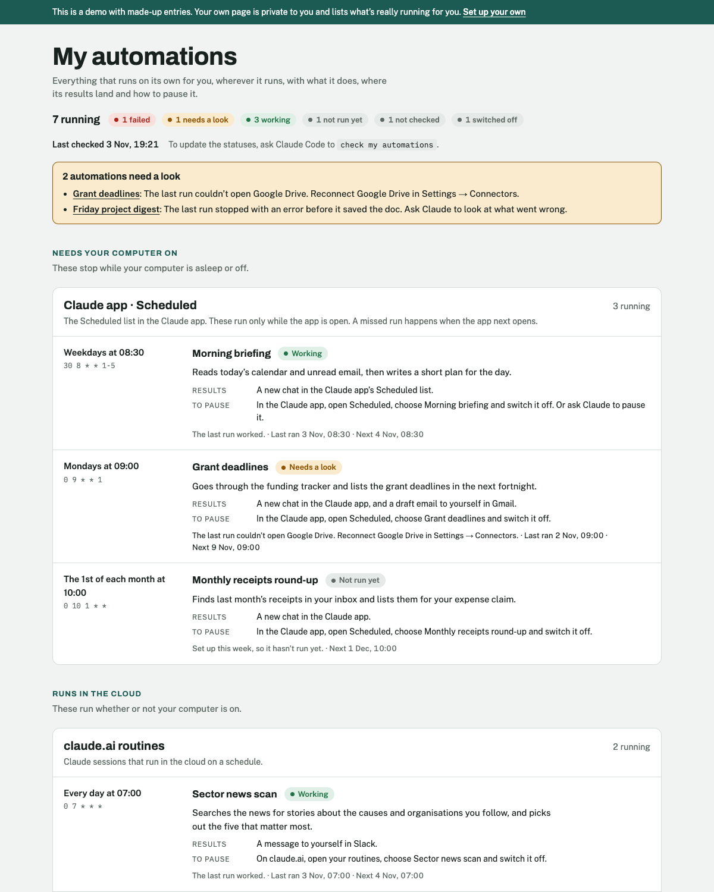

# Automations page

**Runs in:** Claude Code (the Code tab of the Claude desktop app) · **Needs:** no connectors · **Setup:** about 5 minutes

One private page on claude.ai that lists everything running on its own for you, wherever it runs: what each automation does, when it runs, where its results land, how to pause it, and whether it's working. Claude fills it in, keeps it up to date, and checks the statuses when you say "check my automations".

I keep mine pinned in my claude.ai sidebar, and Claude adds to it whenever it sets up something new for me.

## Why keep a list?

Automations are easy to set up and easy to forget. A few months in, you might have a morning briefing in the Claude app, a news scan running as a claude.ai routine and a Zapier zap from last year. Each lives somewhere different, with its own on/off switch, and a broken one usually fails quietly. Scheduled tasks in the Claude app also stop while your computer is off or the app is closed, which is easy to lose track of. The page puts them all in one list, flags the ones that need a look, and says how to pause each one.

## What it looks like



Those are made-up automations. [Try the live demo](https://aidan-alexander.com/claude-tooling/automations-page/demo/).

## What it does

1. **Publishes your page:** a private page on claude.ai. Nobody else can see it unless you share it.
2. **Fills it in:** finds your scheduled tasks in the Claude app and your claude.ai routines, and asks you about anything in other tools, such as Zapier or GitHub Actions.
3. **Writes a plain entry for each:** what it does, when it runs, where its results land and how to pause it.
4. **Checks the statuses when you ask:** "check my automations" looks at each one, updates the page and tells you what failed or needs a look. Checking only reads: it never switches anything on or off.
5. **Keeps the list current**, if you like: whenever Claude sets up, changes, pauses or removes an automation for you, it updates the page in the same session.

## Choices you'll be asked about at setup

| Choice | Options | What I use |
|---|---|---|
| Other tools | Also list automations Claude can't see itself (Zapier, GitHub Actions, jobs on your computer…), or only the ones in Claude | All of them |
| Keeping it current | A short rule in your Claude instructions, so Claude updates the page whenever it changes an automation, or only when you ask | The rule |
| Sidebar | Pin the page in your claude.ai sidebar, or just keep the link | Pinned |

You can change any of these later by asking Claude ("add my Zapier zaps to my automations page").

## Set it up

1. If you haven't used Claude Code before, follow [Getting started](../GETTING-STARTED.md) first (about 10 minutes, once).
2. Start a new session in Claude Code and paste this in:

```
Set up "automations-page" from Aidan's Claude toolkit. If the aidan-toolkit plugin isn't installed, install it from GitHub first (claude plugin install aidan-toolkit --marketplace Aidan-Alexander/claude-toolkit, using the Claude Code inside the Claude app if claude isn't on the PATH), then follow its automations-page/SETUP.md.
```

Claude installs the toolkit plugin if you don't have it yet, publishes your page, fills it in with what's already running, and asks you the questions above.

## Using it

In any Claude Code session:
- "check my automations"
- "what's running for me?"
- "add my Zapier sign-up zap to my automations page"

Open the page any time from your sidebar or its link. A check takes a minute or two.

## Good to know

- **The page doesn't check anything itself.** It shows what Claude last wrote there. The statuses change when you ask Claude Code to "check my automations".
- **What Claude can see:** your scheduled tasks in the Claude app and your claude.ai routines. It can't look inside Zapier, GitHub, Google Apps Script or your computer's own scheduled jobs, so it asks you about those.
- **Scheduled tasks need the app open:** tasks in the Claude app run only while your computer is on and the app is open, so the page lists them under "Needs your computer on".
- **Privacy:** the page is private until you share it. Anyone you share it with sees the whole list, so never ask Claude to put passwords or keys on it.
- **No special setup:** no Python, no command-line tools, no API keys, no connectors. It works on Mac and Windows, wherever the Claude desktop app does.
- **My version** also has a Refresh button on the page that checks jobs on my Mac and GitHub Actions directly. It needs Python and some hand-editing of the Claude app's settings, so this version leaves it out and Claude does the checking instead.
- **With the rest of the toolkit:** [Automatic actions from calls](../call-actions/) runs as a scheduled task in the Claude app, so it shows up on your page.
- **Updating:** say "update Aidan's toolkit" in Claude Code. Your page keeps its link and its list, and any changes you've asked for are kept: Claude records those in your settings file.
- **Removing:** ask Claude Code to "remove the automations-page skill and its rule in my CLAUDE.md". The page stays on claude.ai until you delete it there, or ask Claude to.

## Changes

- 2026-11-10: The toolkit is now a Claude Code plugin, so setup no longer downloads anything with curl, which auto mode and some organisations' settings blocked. The setup line installs the plugin if you don't have it yet. Your settings now live in `~/.claude/toolkit/`; setting up or updating again moves an older install's settings there for you. To update, say "update Aidan's toolkit".
- 2026-11-03: First version.
