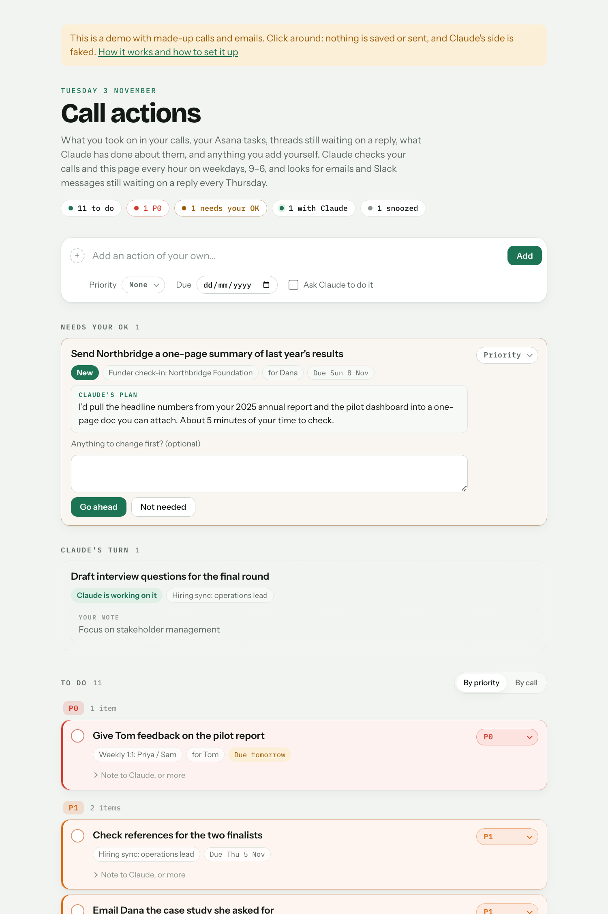

# Automatic actions from calls

**Runs in:** Claude Code (the Code tab of the Claude desktop app), on a schedule · **Needs:** Gmail, plus Granola and Google Drive for calls · **Optional:** Slack, Google Calendar, Google Docs, Asana · **Setup:** about 15 minutes

One page for everything you've said you'll do. After each call you record in Granola, Claude works out what you took on, does the parts it usefully can (drafting the email you promised, digging out the doc you said you'd send) and puts it all on a private tracker page. Once a week it also adds emails and Slack messages you sent that never got a reply, with a follow-up already drafted. You tick things off, snooze them or dismiss them, and you can hand things to Claude from the page.

I keep it open all day. I have a lot of calls, and most end with a handful of small actions: a link to send, an intro to make, a point to raise with someone. I hardly use Asana, so this page is my to-do list, and my few Asana tasks show up on it too. It's how I make sure the things I say yes to in calls actually happen.

## What it looks like



**[Try the live demo](https://aidan-alexander.com/claude-tooling/call-actions/demo/)**: it shows real items from my own tracker, with people's names changed, so click around. Nothing is saved or sent.

## What it does

**After each call** (it checks every hour, or as often as you like):
1. Summarises the call with the [Fancy call summaries](../summarise-granola/) skill, which it installs if you don't have it.
2. Picks out your actions: only the clear ones, where you said you'd do something or agreed to. Not what other people took on, and not "we should…". It leans towards leaving things out, because a false to-do costs you more than a miss.
3. Decides, for each one, whether Claude's help would save you time:
   - **Drafted:** Claude did its part (say, drafted the email you promised) and you check it and send it.
   - **Plans to approve:** a bigger job. Claude says what it would do and how long your review would take, and waits for your go-ahead.
   - **Yours:** it needs you: a decision, a conversation, feedback to someone. Claude adds a useful link if there is one.
4. Adds them to the tracker, linked to the call's summary.

**Once a week** (Thursday afternoons, say):
5. Finds emails and Slack messages you sent more than a week ago that never got a reply, and ones sent to you that you haven't answered after a few days. It checks they weren't settled somewhere else, and adds the ones worth acting on, with a short follow-up email drafted on the thread (or a reply, when the answer is clear). When the thread moves on, the item ticks itself off.

**About once an hour, if you use Asana** (optional):
6. Brings in your open Asana tasks, so the tracker is your one list. Tasks you finish in Asana tick themselves off here. If you choose, ticking one off here also completes it in Asana: the only thing it ever changes there.

**On the page you can:**
- tick items off, set priorities (anything due tomorrow turns top priority by itself), snooze items for a day to a month, or drop or dismiss them with a reason;
- add your own items, and tick "Ask Claude to do it";
- leave Claude a note on any item ("make the draft shorter");
- tell Claude how to work in the "Tell Claude" box ("don't draft emails to my manager"). It applies that from then on, and learns from your reasons for dropping things.

## Choices on the setup screen

Your page opens on a short setup screen with recommended defaults pre-selected. The rest of the choices are under the settings gear at the top right of the page, where you can also change everything below later, apart from the start date. Choices that don't fit what you pick it to cover drop out: the follow-up check if you pick calls only, and how often it checks, your 1:1 docs, call summaries and the start date if you pick follow-ups only (that check runs once a week).

| Choice | Options | What I use |
|---|---|---|
| What it covers | Calls and follow-ups, calls only, or follow-ups only (no Granola needed) | Both |
| How often it checks for calls | Every hour (recommended for Claude Pro), every 10 minutes (recommended for Claude Max), or twice a day, within the working hours you pick | Every 10 minutes, weekdays 09:00–19:00 (I have Claude Max) |
| What Claude does with your actions | Does things for you and you can undo them; asks before doing anything (every change to your docs or calendar becomes a plan to approve); or just lists them. Either way it drafts, and never sends anything: you review and click send | Does things for me, and I undo the odd one |
| What Claude may change | Add agenda points to your 1:1 docs ("I'll raise that with Priya" becomes a line in your 1:1 doc with Priya); block time in your calendar when you ask, never with guests; change your existing Google Docs when you ask, never other people's text, comments or sharing. Untick one and Claude never makes that change: it suggests it for you to make yourself | All three |
| Your 1:1 docs | Each person you meet regularly and your shared doc with them, for agenda points and summary links | My direct reports' docs |
| Checking for messages waiting on a reply | Email only, or email and Slack; draft follow-up and reply emails or not. Under the gear: which day and time, and who to leave out | Both, drafts on, Thursdays at 14:00, freelancers left out |
| Asana tasks | Leave them out or include them. Under the gear: whether ticking one off here completes it in Asana too (on to start with) | Include them, and complete them in Asana too |
| Claude model and effort (under the gear) | Model: same as your Claude app, Opus (recommended for Claude Max) or Sonnet (recommended for Claude Pro). Effort, how much it thinks before each step: same as your app, low, medium (recommended) or high | Opus, at my app's effort |
| How email drafts end (under the gear) | Your usual sign-off and name, or nothing (your signature covers it); optionally "Co-written with Claude" | Nothing, plus "Co-written with Claude" |
| Call summaries (under the gear) | Detailed or one page; a tidied transcript always or only when you ask; British or American spelling | Detailed, always, British |
| Start from (setup only) | The first day whose calls Claude picks up; it looks back a week at most | The day I set it up |

You can change any of these later in the settings gear, or anything else about how it works by asking Claude.

## Set it up

1. If you haven't used Claude Code before, follow [Getting started](../GETTING-STARTED.md) first (about 10 minutes, once).
2. In Claude, open **Settings → Connectors** and connect **Gmail**, plus **Granola** and **Google Drive** if you want it to cover calls. Slack, Google Calendar, Google Docs and Asana are optional.
3. Start a new session in Claude Code and paste this in:

```
Set up "call-actions" from Aidan's Claude toolkit. If the aidan-toolkit plugin isn't installed, install it from GitHub first (claude plugin install aidan-toolkit --marketplace Aidan-Alexander/claude-toolkit, using the Claude Code inside the Claude app if claude isn't on the PATH), then follow its call-actions/SETUP.md.
```

Claude installs the toolkit plugin if you don't have it yet, checks your connectors, and makes your private tracker page, pinned to your claude.ai sidebar. The page opens on the setup screen above: pick your choices, paste your 1:1 doc links, click "Save and finish setup", and tell Claude "done". Claude then makes your summaries folder, schedules the checks, and offers a first run, so your page starts with something on it.

## Using it

- **The page:** it's pinned to your claude.ai sidebar. Keep it open: it updates live.
- **Run it now:** say "check my calls" in Claude Code.
- **Pause it:** in the Claude app's sidebar, open Scheduled → Call actions and switch it off.
- **Update it:** say "update Aidan's toolkit". Your settings, your own rules and your tracker are kept.

## Good to know

- **It never sends anything.** Emails become Gmail drafts and Slack messages become Slack drafts: you do the sending. It doesn't edit your existing files either, apart from the optional agenda points, calendar holds, doc changes you ask for, and ticking off Asana tasks.
- **The page is private.** Only you can open it, and only you can ask Claude to do things through it.
- **It runs while the Claude desktop app is open.** If your laptop was shut, it catches up when you next open the app.
- **Usage:** each check is a short Claude session, and each call's summary and actions take more. Checking hourly is the lighter choice, and so are Sonnet and a lower effort, under the settings gear.
- **Accuracy:** it's built to under-claim. When it gets something wrong, drop the item with a reason, or say so in the "Tell Claude" box.
- **No special setup:** no Python, no API keys, no Slack bots. Claude does all of the setting up.

## Changes

- 2026-11-03: First version in the toolkit, with the weekly follow-up check, snoozing and optional Asana tasks.
- 2026-11-04: The page now looks like the toolkit website: a warm white page, white cards, pill buttons, and the priority colour as each card's top edge. It's always light, with no dark mode.
- 2026-11-04: Things Claude did itself, like a calendar hold or an agenda point, now show as "Claude did it", with "Thanks Claude!", "Change something" and "Drop" buttons. The note box's buttons now say what they do: "Ask Claude to do it" (or "Ask Claude to change it" on a draft), "Ask a question" and "Drop".
- 2026-11-05: Agenda points Claude adds to a 1:1 doc now end in an italic "Added by Claude", and use the cell's own kind of bullet, so checkboxes stay checkboxes.
- 2026-11-05: The top of the page says when Claude last checked for calls, and lists any calls that aren't in yet (still going, or the transcript isn't ready). It turns amber if the scheduled run seems to have stopped.
- 2026-11-05: New setup choice, off unless you turn it on: Claude can change an existing Google Doc when you ask on the tracker, instead of only making new ones.
- 2026-11-05: Agenda points go in the tab where your meetings with that person are (a shared doc with a tab per person works), and are marked the way the doc marks your own points, such as your initials.
- 2026-11-05: A pencil by each to-do lets you fix its title and description; Claude treats your edits as corrections. Asana tasks now say what they're part of: a subtask shows its parent ("Volunteer impact report › Review"), the title links to Asana, and Claude adds a line of context.
- 2026-11-05: "By call" is now the first view, with Asana tasks below your calls.
- 2026-11-05: Things Claude did now have a "Give feedback" button: a lesson for next time that doesn't change the item. Your notes and Claude's replies show as a short chat, yours on the right.
- 2026-11-05: Things Claude did now have Undo instead of Drop: Claude deletes what it made for that item (the hold, the agenda point, the doc or the draft) on its next check, and nothing else. Sending feedback ticks the item off, like Thanks Claude!
- 2026-11-05: The tallies at the top are filters: click "drafts waiting for you" or "done by Claude" (or "urgent", or overdue) to see just those, and again for everything.
- 2026-11-05: A settings gear at the top right of the page: change what it covers, summary length and spelling, the follow-up day, agenda points, calendar holds, doc edits, your 1:1 docs, Asana, the Monday digest and the start date, any time. Claude reads them at the start of every check.
- 2026-11-05: A search box above your to-dos (press / to jump to it). It also narrows Snoozed and Done, and opens them when they have a match.
- 2026-11-06: The P0 tally is now "urgent": anything that's P0 or due by tomorrow (overdue included), whatever priority you gave it.
- 2026-11-06: The page is titled with your first name ("Sam's call actions"), which you can change under the settings gear. "Needs your OK" is now "Plans to approve".
- 2026-11-06: Setup happens on your page: it opens on a setup screen with every choice as a checkbox or radio button, my choices already picked. Your first name comes from Granola. The settings gear now also has how often and when Claude checks (days and hours), and changing them updates the schedule.
- 2026-11-05: Setup now pins the tracker page to your claude.ai sidebar, instead of offering to. Updating pins it too, if it isn't already.
- 2026-11-06: A shorter setup screen: only what matters on day one, with recommended defaults pre-selected. Writing style, summaries, the follow-up day and your name are under the settings gear, which shows during setup so you know where to find it; the start date is only on the setup screen. Working hours fold away under "Choose working hours".
- 2026-11-06: New choices under the gear: which Claude model does the work, and its effort (how much it thinks before each step). Opus is the most careful; Sonnet and lower effort use less of your Claude allowance.
- 2026-11-06: A ↻ button by "Calls last checked" says where to start a check straight away (Scheduled → Call actions → Run now in the Claude app). A page can't start a scheduled check itself.
- 2026-11-06: Checks take turns, and a call that a stopped check left half-done is taken over at the next one instead of after 2 hours. Each summary's link is saved the moment the doc exists, so a taken-over call isn't summarised twice.
- 2026-11-06: The weekly check also finds messages sent to you that you haven't answered (after three days), not just yours that never got a reply. They show as "waiting on you".
- 2026-11-06: "What Claude does with your actions" has three options: Claude does things for you and you can undo them (as before), asks before doing anything (every agenda point, calendar block and doc edit becomes a plan to approve), or just lists them.
- 2026-11-06: The Monday digest is gone: the page itself is the list. When agenda points, calendar holds or doc edits are off, Claude now suggests them for you to do instead.
- 2026-11-06: Fixes from a test install: calls are listed with Granola's `search_meetings` (the connector no longer has `list_meetings`); setup falls back to Python when curl isn't allowed, takes your first name from your sent email, and records the schedule it sets; the follow-up check counts "7 days" by date, and searches Slack in smaller stretches (its search stops at about 180 results).
- 2026-11-09: A due date removed in Asana is now removed from your page too, so the task stops showing as overdue.
- 2026-11-10: The toolkit is now a Claude Code plugin, so setup no longer downloads anything with curl, which auto mode and some organisations' settings blocked. The setup line installs the plugin if you don't have it yet. Your settings now live in `~/.claude/toolkit/`; setting up or updating again moves an older install's settings there for you. To update, say "update Aidan's toolkit".
- 2026-11-11: Docs Claude drafts for you have a one-line AI disclaimer under their title: what Claude drafted it from, and how involved you've been so far (by default, that you haven't reviewed it). Claude brings the line up to date when it revises one of its own docs.
- 2026-11-12: A call checked in its first minutes, before Granola had stored any transcript, is no longer dropped as "no transcript": later checks look again for up to 12 hours.
- 2026-11-12: Every call on the page opens something: its summary doc, or its Granola note when the summary's link is missing.
