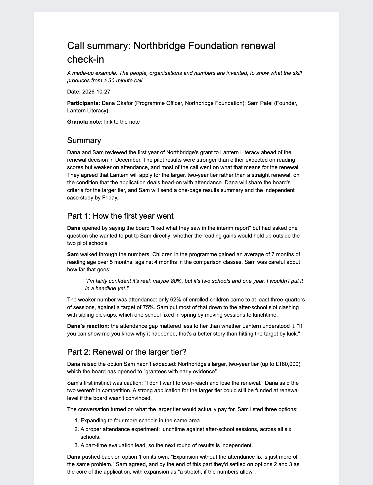

# Call summaries from Granola

**Runs in:** Claude Code (the Code tab of the Claude desktop app) · **Needs:** Granola and Google Drive connectors · **Setup:** about 5 minutes

Say "summarise my last call" and Claude turns the call's Granola transcript into a detailed summary in a new Google Doc: what was discussed in the order it happened, who thought what and why, what was decided, and who's doing what next.

I use it after nearly every call, and now run it automatically with the [call actions tracker](../call-actions/).

## Why not just use Granola's notes?

Granola's own notes are a quick list of bullets. These summaries tell the story of the call instead: the reasoning behind decisions, changes of mind, the exact words for commitments and hedges ("probably", "70% sure"), plus open questions and key quotes. They're written so you can re-live a call weeks later, or pick up a thread you'd half forgotten. A meaty 45-minute call gets 2,000–4,000 words; a quick check-in gets far fewer. If you'd rather have a one-pager, you can choose that at setup.

## What it looks like



That's a made-up call. [Read the whole example summary](example-summary.md).

## What it does

1. **Picks the call:** the one you name, or the one that just ended. If neither is obvious, it shows you your recent calls to choose from.
2. **Reads the whole transcript** from Granola, however long.
3. **Works out who said what.** Granola's speaker labels are often wrong, especially when a room shares one laptop, so it checks them against what was said and marks anything it's unsure of with "(?)".
4. **Writes the summary** and saves it as a Google Doc, in a "Call summaries" folder if you like.
5. **Optionally** adds a tidied transcript to the end of the doc, and a dated link to the summary at the top of your 1:1 doc with that person.
6. **Gives you the link.** It never sends or shares anything: the doc is private until you share it.

## Choices you'll be asked about at setup

| Choice | Options | What I use |
|---|---|---|
| Length | Detailed narrative, or a one-page summary | Detailed |
| Tidied transcript at the end | Always, only when you ask, or never | Always |
| Spelling | British or American English | British |
| Where docs go | A "Call summaries" folder, or the top of My Drive | The folder |
| 1:1 docs | Add a dated link to each summary at the top of your running doc with that person | Yes, for my direct reports |

You can change any of these later by asking Claude ("make my call summaries shorter").

## Set it up

1. If you haven't used Claude Code before, follow [Getting started](../GETTING-STARTED.md) first (about 10 minutes, once).
2. In Claude, open **Settings → Connectors** and connect **Granola** and **Google Drive**. For the 1:1 doc links, connect **Google Docs** too.
3. Start a new session in Claude Code and paste this in:

```
Set up "summarise-granola" from Aidan's Claude toolkit. Fetch https://raw.githubusercontent.com/Aidan-Alexander/claude-toolkit/main/summarise-granola/SETUP.md exactly as written (e.g. with curl) and follow it.
```

Claude downloads the skill, asks you the questions above, and offers to summarise your last call as a test.

## Using it

In any Claude Code session:
- "summarise my last call"
- "summarise my call with Priya on Tuesday"
- `/summarise-granola`

A summary takes a few minutes. You can keep working in another session while it runs.

## Good to know

- **Accuracy:** skim before you rely on it. The usual weak spot is who-said-what in in-person meetings recorded on one laptop, which it flags.
- **Privacy:** the transcript is read by Claude under your account. The doc it creates is in your Drive and private to you.
- **Usage:** a detailed summary of an hour-long call uses a fair amount of your Claude plan's usage, roughly what a long chat would.
- **No special setup:** no Python, no command-line tools, no API keys. It works on Mac and Windows, wherever Claude Code and Granola do.
- **Updating:** paste the setup line again. Your settings are kept.
- **Removing:** ask Claude Code to "remove the summarise-granola skill".

## Credits

This grew out of [HartreeWorks' summarise-call skill](https://github.com/HartreeWorks/skill--summarise-call). My own, more technical version (Python scripts, which need a Mac) is at [Aidan-Alexander/summarise-granola](https://github.com/Aidan-Alexander/summarise-granola). You don't need it: this version does the same job with connectors alone.

## Changes

- 2026-11-03: First version in the toolkit: connectors only, with setup questions.
